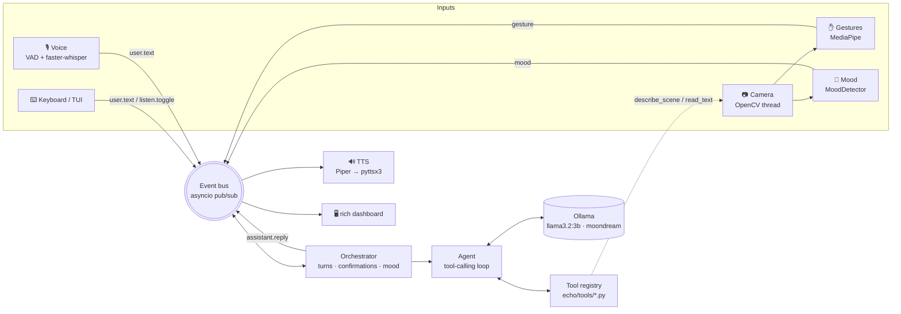

# Echo

**A private, local-first multimodal assistant that listens, sees, and acts on your computer, with nothing leaving your machine.**

<!-- Placeholder: replace docs/demo.gif with a real recording (e.g. `vhs` or `asciinema` + `agg`). -->


## Features

| | |
|---|---|
| 🎙️ **Voice** | Push-to-talk (Enter / ✋) or wake word (“hey echo”), speech-to-text with **faster-whisper**, spoken replies with **Piper**, falling back to **pyttsx3** |
| 🧠 **Brain** | Local LLM through **Ollama** (`llama3.2:3b`). The LLM chooses tools itself in a tool-calling loop |
| 🧰 **Tools** | `open_app`, `web_search`, `notes`, `summarize_pdf`, `system_info`, `describe_scene`, `read_text`. It's a plugin architecture with one file per tool |
| 👁️ **Vision** | Webcam via OpenCV: *“what do you see?”* uses **moondream**, and *“read this”* runs OCR (Tesseract if installed, otherwise moondream) |
| ✋ **Gestures** | MediaPipe hand tracking: **open palm** starts listening, **fist** stops, **thumbs up** confirms an action |
| 🙂 **Mood** | A pluggable facial-emotion detector changes the reply tone. It's a placeholder for now and ready for [MoodLens](#plugging-in-moodlens) |
| 🖥️ **Terminal UI** | A live `rich` dashboard shows the state of every module and the conversation |
| 🛟 **Graceful fallback** | No mic, camera or Ollama? Echo keeps running. If the LLM is down, simple commands still work through an offline intent router |

## Architecture



All modules run concurrently on one asyncio loop. Blocking work (camera capture, Whisper, MediaPipe, TTS) runs on worker threads. Each module reports its status (`ready`, `active`, `unavailable`...), and a module that fails to start is marked unavailable without affecting the others.

## Install

**Requirements:** Python 3.11, [Ollama](https://ollama.com), a webcam and a microphone (both optional).

```bash
# 1. System libraries (Debian/Ubuntu; use brew on macOS)
sudo apt install libportaudio2 espeak-ng        # mic + fallback voice
sudo apt install tesseract-ocr                  # optional, faster OCR

# 2. Local models
curl -fsSL https://ollama.com/install.sh | sh
ollama pull llama3.2:3b
ollama pull moondream

# 3. Python environment
git clone <this repo> echo && cd echo
python3.11 -m venv .venv && source .venv/bin/activate
pip install -r requirements.txt                 # + requirements-dev.txt for tests

# 4. A Piper voice (neural TTS)
python -m piper.download_voices en_US-lessac-medium --download-dir ~/.echo/voices

# 5. Run
python -m echo
```

On first run, faster-whisper downloads `base.en` and MediaPipe downloads its hand model to `~/.echo/models`. After that everything runs offline except `web_search`, which you can disable in `config.yaml` with `tools.disabled: [web_search]`.

### Options

```bash
python -m echo --text-only    # keyboard only: no mic, speakers or camera
python -m echo --no-ui        # plain line-based output (also used automatically when piped)
python -m echo -c my.yaml     # another config file (or set $ECHO_CONFIG)
python -m echo --debug        # verbose logs in ~/.echo/logs/echo.log
```

## Using Echo

| Do this | And Echo… |
|---|---|
| Type a message + Enter | answers (and speaks) |
| Enter on an empty line, or show ✋ | starts listening; stops when you pause, press Enter again, or show ✊ |
| Say “hey echo, …” (`audio.mode: wake_word`) | listens hands-free |
| “Open Firefox” | asks for confirmation; give it 👍 or say “yes” |
| “What do you see?” / “Read this” | describes the webcam scene / reads the text you hold up |
| “Take a note: buy oat milk” · “search my notes for milk” | manages Markdown notes in `~/.echo/notes` |
| “Summarize ~/Documents/report.pdf” | summarizes a local PDF (map-reduce over chunks) |
| “Search the web for …” | searches DuckDuckGo and summarizes |
| “How's my battery?” | time, date, battery, CPU, memory |
| `/quit` or Ctrl-C | exits |

All settings are in [`config.yaml`](config.yaml). Every key is optional, and unknown keys are rejected so typos don't go unnoticed.

## Add a new tool in 5 lines

Drop a file into `echo/tools/`. It is discovered automatically, and the LLM sees its name and description:

```python
# echo/tools/roll_dice.py
import random
from echo.tools.base import Tool
class RollDice(Tool):
    name, description = "roll_dice", "Roll a six-sided die."
    async def run(self, ctx, **kw): return f"You rolled a {random.randint(1, 6)}."
```

To take arguments, add a JSON-schema `parameters` dict. Set `requires_confirmation = True` to ask for a 👍 before the tool runs. `ctx` gives the tool access to the config, the LLM (`await ctx.ask_llm(...)`), the camera (`ctx.vision`) and the event bus.

## Plugging in MoodLens

Implement one method and point the config at your class:

```python
# moodlens/echo_adapter.py
from echo.vision.mood import MoodReading

class MoodLensDetector:
    def detect(self, frame):            # frame: BGR numpy array from OpenCV
        emotion, confidence = my_model.predict(frame)
        return MoodReading(emotion, confidence)   # or None when no face is visible
```

```yaml
mood:
  provider: moodlens.echo_adapter:MoodLensDetector
```

Supported emotions and their tones are listed in [`echo/llm/prompts.py`](echo/llm/prompts.py).

## Project layout

```
echo/
├── core/     config · event bus · module base · orchestrator · logging
├── llm/      Ollama client · agent loop · prompts · offline intents
├── audio/    microphone · VAD · faster-whisper · TTS · voice module
├── vision/   camera · vision service (describe/OCR) · gestures · mood
├── tools/    one file per tool (auto-discovered)
└── ui/       rich dashboard · keyboard reader · plain UI
tests/        pytest suite (orchestrator, agent, every tool, perception logic, UI)
```

## Development

```bash
pip install -r requirements-dev.txt
pytest                  # hardware-free: LLM, camera, mic and web are faked
mypy echo --strict
ruff check echo tests
```

## Privacy

Speech recognition, speech synthesis, the LLM, the vision model, gesture tracking and mood detection all run on your machine. Notes stay in `~/.echo/notes`. The only network traffic is `web_search` (DuckDuckGo) and the one-time model downloads.

## License

[MIT](LICENSE)
